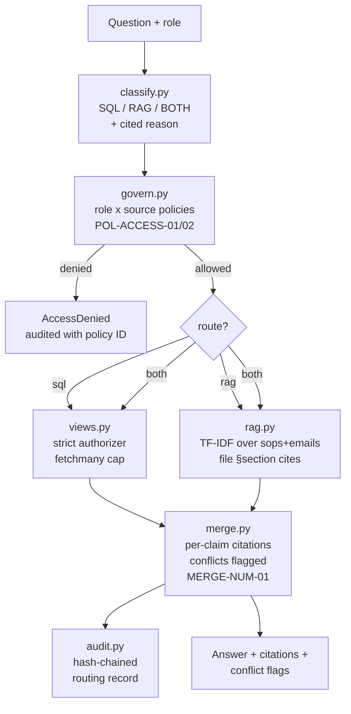

# Architecture



## Data flow

1. `router.answer(question, role)` classifies the question into a route
   with a cited reason ID.
2. Every target view and doc set is policy-checked for the role *before*
   any query runs. Denials raise `AccessDenied` and are audited.
3. SQL path: fixed per-view queries through the hardened gateway
   (text allowlist + role-scoped strict view-aware authorizer in authz.py + fetchmany cap).
4. RAG path: TF-IDF over SOPs and (role permitting) email threads.
5. Merge: claims carry `sql:<view>` or `file §section` citations;
   numeric conflicts prefer the database but are always surfaced.
6. The whole decision (question, route, reason, policy checks, sources,
   claim/conflict counts) is appended to the hash-chained audit log.

## Key files

| File | Responsibility |
|---|---|
| `router/classify.py` | Route + cited reason |
| `router/govern.py` | Role x source policies |
| `router/views.py` | Views + hardened gateway |
| `router/rag.py` | TF-IDF retrieval |
| `router/merge.py` | Citation merge + conflicts |
| `router/audit.py` | Hash-chained log |
| `router/router.py` | Orchestrates the five steps |
```
